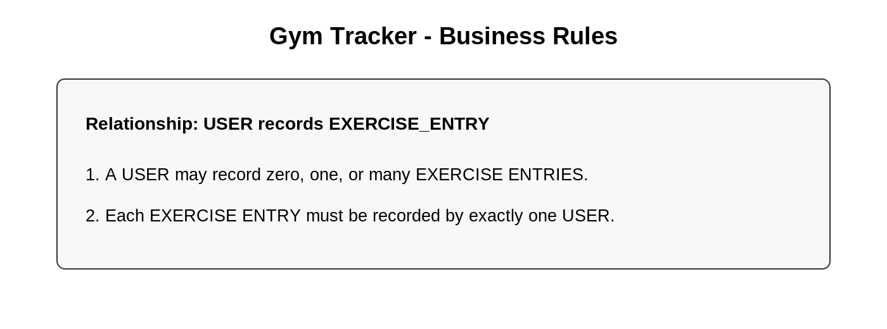
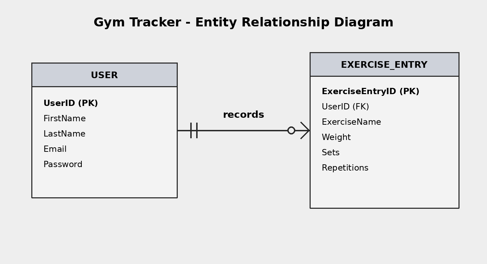
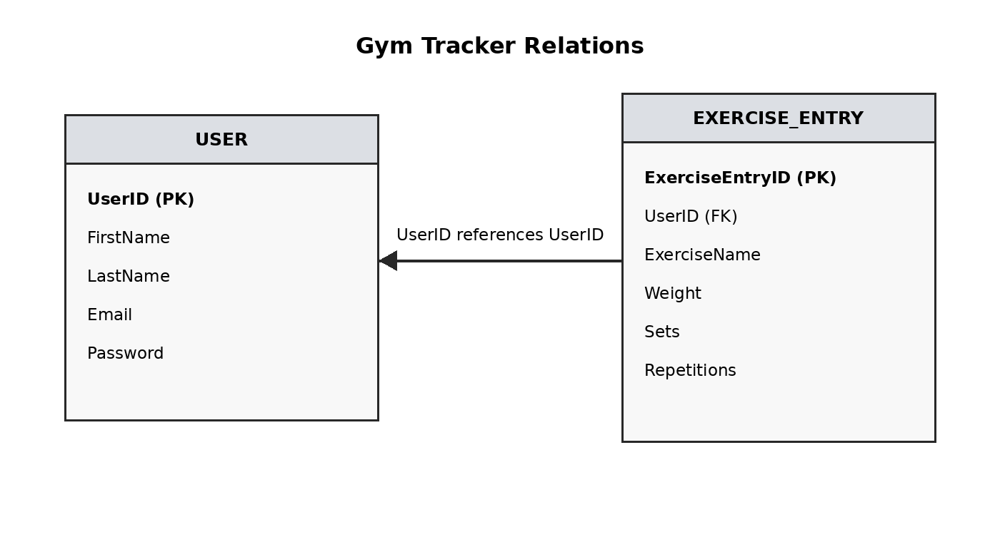

# Gym Tracker

## Project Description

Gym Tracker is an application that allows users to keep track of their gym workouts and exercises. Users will eventually be able to create an account, log in, and record information about the exercises they perform.

## Purpose

The purpose of Gym Tracker is to give people who go to the gym a simple way to save and manage their exercise information in one place.

## Intended Users

The intended users are people who go to the gym and want a simple way to keep track of their workouts.

## Main Features

- User registration
- User login
- Add exercise entries
- Record exercise information such as exercise name, weight, sets, and repetitions
- View exercise entries
- Edit exercise entries
- Delete exercise entries

## Main Entities

The two main entities in the application are:

- `USER`
- `EXERCISE_ENTRY`

### USER Attributes

- `UserID` - Primary Key
- `FirstName`
- `LastName`
- `Email`
- `Password`

### EXERCISE_ENTRY Attributes

- `ExerciseEntryID` - Primary Key
- `UserID` - Foreign Key
- `ExerciseName`
- `Weight`
- `Sets`
- `Repetitions`

## Business Rules

**Relationship:** `USER` records `EXERCISE_ENTRY`

1. A USER may record zero, one, or many EXERCISE ENTRIES.
2. Each EXERCISE ENTRY must be recorded by exactly one USER.

## Entity Relationship Diagram

The ERD shows the entities in the Gym Tracker database, their attributes, and how they are related. Its purpose is to show the overall structure of the database before the tables are created.

## Relations

The relations diagram shows how the entities from the ERD will be represented as database tables. It also shows the primary keys and the foreign key used to connect an exercise entry to a user.

**USER**(`UserID`, FirstName, LastName, Email, Password)

**EXERCISE_ENTRY**(`ExerciseEntryID`, UserID, ExerciseName, Weight, Sets, Repetitions)

- `UserID` is the primary key of USER.
- `ExerciseEntryID` is the primary key of EXERCISE_ENTRY.
- `UserID` in EXERCISE_ENTRY is a foreign key that references USER.

## Normalization

The relations are in **1NF, 2NF, and 3NF**.

- **1NF:** Each attribute contains one value and each relation has a primary key.
- **2NF:** Each relation has a single-attribute primary key, so every non-key attribute depends on the whole primary key.
- **3NF:** The non-key attributes depend on the primary key and not on another non-key attribute.

No changes are needed because the relations already meet 1NF, 2NF, and 3NF.

## Database Implementation

The database was implemented using **MySQL**.

The two tables implemented are:

- `users`
- `exercise_entries`

The `exercise_entries` table is related to the `users` table through `user_id`. Each exercise entry belongs to one user, and one user can have many exercise entries.

[View schema.sql](schema.sql)

### Table Creation

### Created Tables

